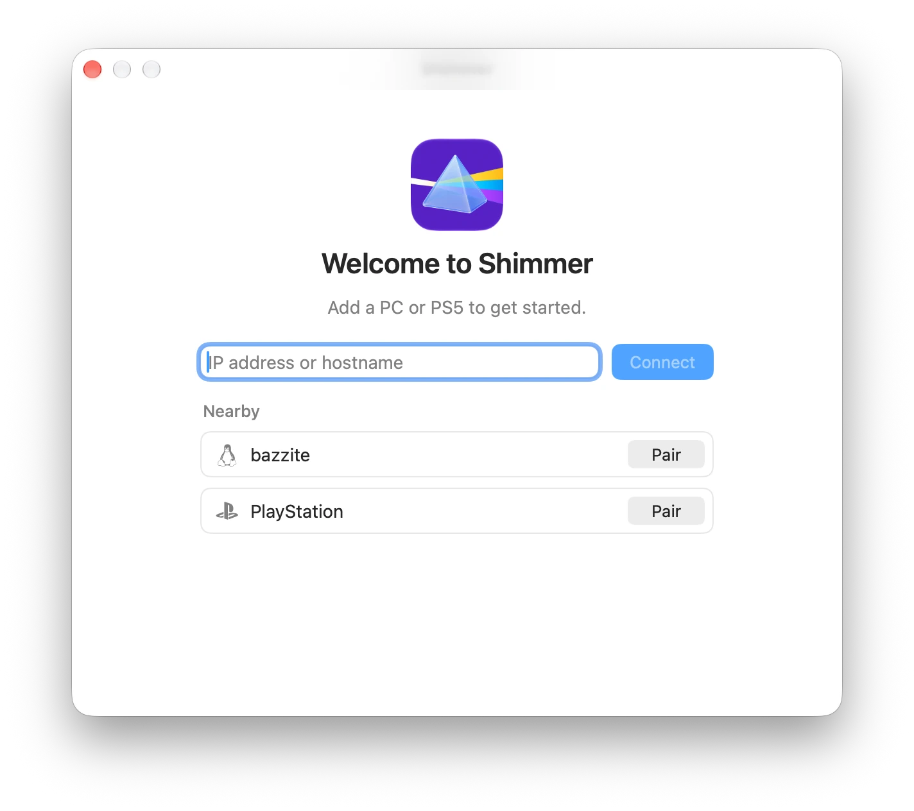
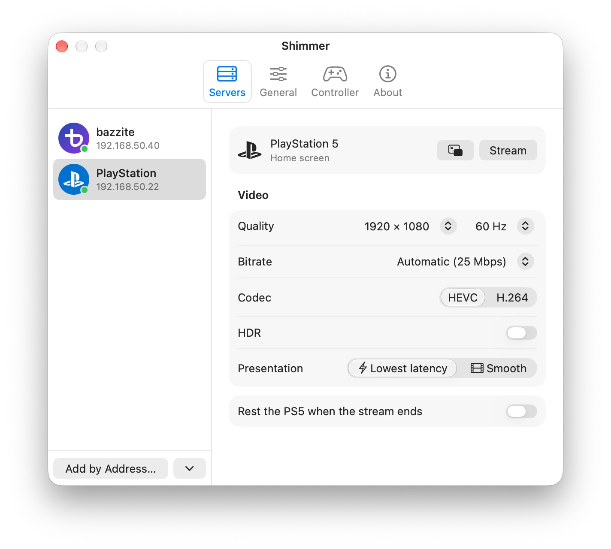
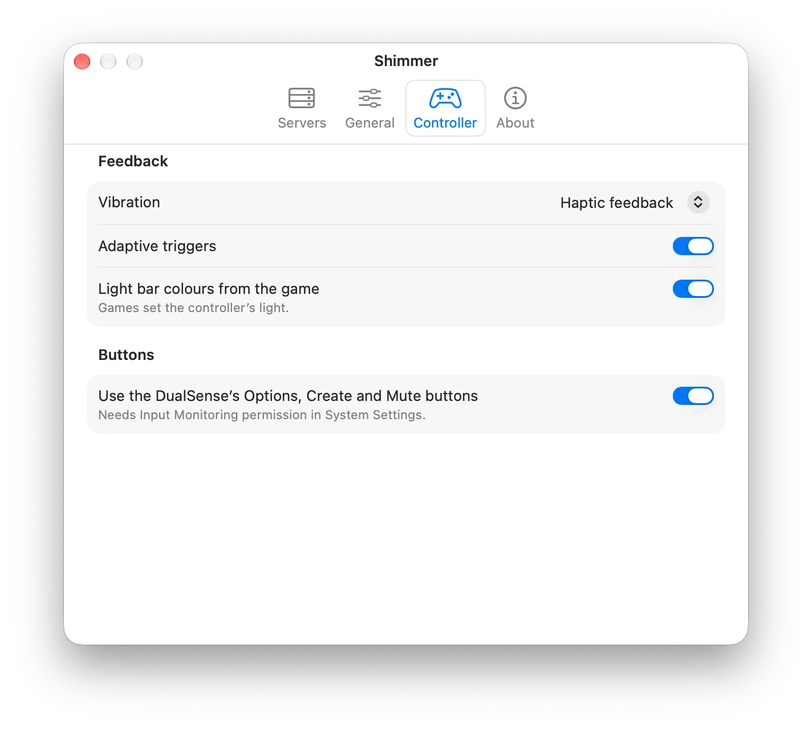
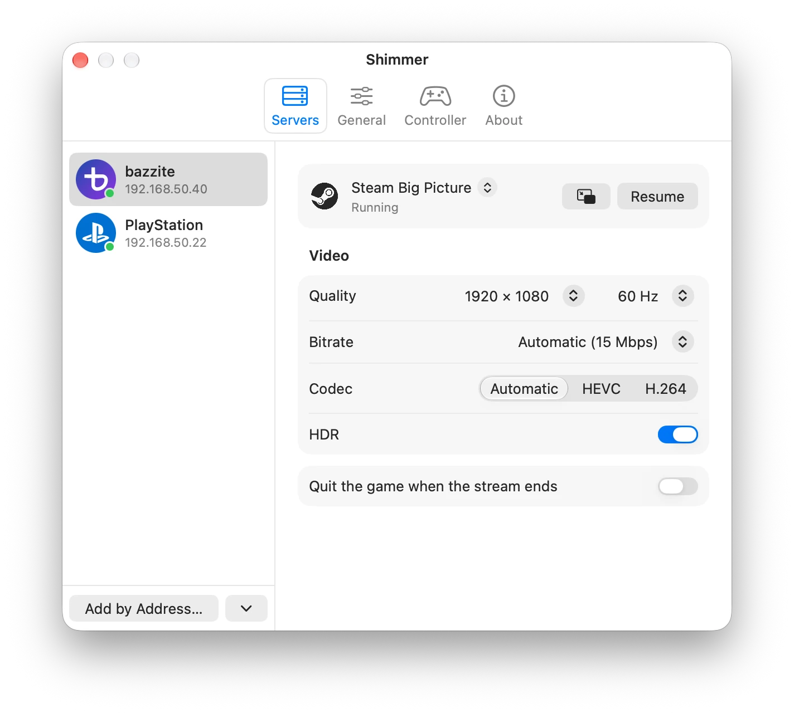
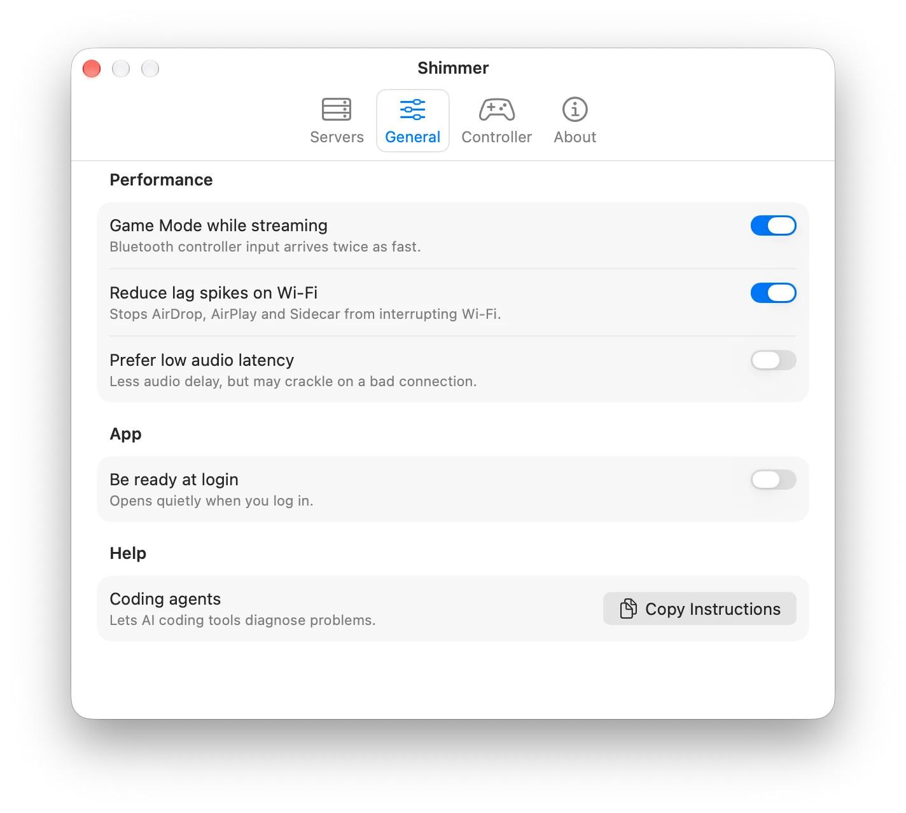

<p align="center">
  
</p>

<h1 align="center">Shimmer</h1>

<p align="center">
  Stream games from your PC or PS5 to your Mac, and keep playing in Picture in Picture.
</p>

<p align="center">
  <a href="https://github.com/slaughterhousesoftware/shimmer/releases/latest"><b>Download Shimmer 1.0</b></a>
  &nbsp;·&nbsp; macOS 26 or later, Apple silicon &nbsp;·&nbsp; Free and open source (GPLv3)
</p>

<p align="center">
  
</p>

Shimmer is a native Mac client for game streaming. It plays games from a PC
running [Sunshine](https://github.com/LizardByte/Sunshine) (the host side of
Moonlight), or from a PlayStation 5 over Remote Play. The stream can pop out
into macOS Picture in Picture, so the game floats over everything else while
your controller keeps playing it.

## Picture in Picture

Press ⌃⌥P during a stream, or pick Picture in Picture in the menu bar, and the
game moves into the system's floating PiP window. It stays on top of other
apps, Spaces and full-screen windows, and can pop out on its own when you
switch apps. The controller keeps driving the game, and the mouse over the PiP
window moves the PC's pointer.

It uses the same display layer the stream already draws into, so there is no
second decoder, and the game keeps its frame rate through Stage Manager,
Mission Control and locking the screen.

## PlayStation 5

A PS5 on your network shows up under Nearby. Pick it, sign in to PlayStation
Network once, and enter the code from **Settings › System › Remote Play › Pair
Device** on the console. After that it's listed like a PC. Stream wakes it from
rest mode, and the stream gets the same window, Picture in Picture, audio and
controller support.

<p align="center">
  
  
</p>

The PS5 sends 1080p or 720p at up to 60 fps. It only takes controller input,
so without a controller the keyboard drives a virtual one (WASD and IJKL for
the sticks, arrows for the D-pad, Return for Cross, Backspace for Circle, H for
PS). Shimmer connects to the console directly, so it must be on the same
network or reachable through a Tailscale subnet route.

## DualSense

With a DualSense, you get what the console or game sends:

- **Adaptive triggers**, from the PS5 and from PC games that use them.
- **Haptics** played on the controller's own actuators, not converted to rumble.
  Over USB they play exactly as the console sends them. Over Bluetooth they go
  in the controller's haptics report, as closely as the Mac's Bluetooth link
  allows: it carries about 33 reports a second, so dense effects can lose some
  detail while short ones come through whole.
- **Light bar** colours from the game.
- **Touchpad and motion** sent back to the game.

Other controllers macOS supports, such as Xbox, Switch Pro and DualShock 4
pads, work too.

<p align="center">
  
</p>

## Made for the menu bar

Shimmer lives in the menu bar. The icon shows the connected controller and its
battery, drawn after Steam's controller icons, or the game you're streaming,
and turns into a spinner while it connects.

<p align="center">
  
</p>
<p align="center">
  
</p>

Its menu starts, resumes and ends streams, opens Picture in Picture, and sets
each server's resolution, frame rate, bitrate and HDR without opening a window.

## One window

The Servers tab lists your PCs and PS5s, pairs new ones in place, and holds
each machine's stream settings. General and Controller hold the rest. The
layout takes after Tailscale's Mac app.

<p align="center">
  
  
</p>

## Also

- Hardware-decoded H.264, HEVC and AV1, with HDR.
- Mouse and keyboard forwarding, or controller-only play.
- PC discovery, PIN pairing, and import of moonlight-qt pairings.
- A second address per PC, such as a Tailscale address, used when the home
  address isn't reachable.
- **Reduce lag spikes on Wi-Fi** pauses AirDrop, AirPlay and Sidecar's
  Wi-Fi link while you stream over Wi-Fi. Turning it on asks for your Mac
  password once, to allow exactly `ifconfig awdl0 down` and `up`.
- `shimmerctl`, a command-line tool a coding agent can use to check and fix
  the app. See the [CLI guide](docs/CLI.md).

## Install

Download the DMG from [Releases](https://github.com/slaughterhousesoftware/shimmer/releases/latest)
and drag Shimmer to Applications. It is signed with a Developer ID and
notarized by Apple, and it updates itself through
[Sparkle](https://sparkle-project.org); each update is checked against
Shimmer's own signing key. Every release lists the SHA-256 of its files.

You need macOS 26 or later on Apple silicon, and either a PC running
[Sunshine](https://github.com/LizardByte/Sunshine) or a PS5 with Remote Play
turned on. See [host setup](docs/HOST_SETUP.md).

### Build from source

Requires Xcode 26 or later and Homebrew.

```sh
git clone https://github.com/slaughterhousesoftware/shimmer.git
cd shimmer
brew install openssl@3 opus
make local-signing-setup
make
```

`make local-signing-setup` is a one-time step so macOS keeps Shimmer's
permissions across rebuilds. `make` builds and installs
`/Applications/Shimmer.app`, and `make test` runs the tests.

## Known issues

- On macOS 27.2, the menu bar menu doesn't open while another app is full
  screen.
- PS5 streams top out at 1080p60; that's what Remote Play sends.
- DualSense haptics over Bluetooth can lose detail in dense effects (see
  above). USB is exact.

## Under the hood

Shimmer is a fork of [glimmer](https://github.com/Se7enbrc/glimmer) by
[Se7enbrc](https://github.com/Se7enbrc), based on glimmer 2026.9.0 with fixes
ported from later releases. The whole pipeline is Swift in one process:
network, VideoToolbox decode, display, audio and input. PS5 streams use
[chiaki-ng](https://github.com/streetpea/chiaki-ng)'s libchiaki for the Remote
Play protocol and feed the same decoder, window and controller code. DualSense
haptics over Bluetooth build on the work of SAxense, DS5Dongle and P5M.

glimmer has since moved on and has features Shimmer doesn't, such as iOS apps
and its own Mini Player. See [architecture](docs/ARCHITECTURE.md),
[security](docs/SECURITY.md) and the [changelog](CHANGELOG.md).

Shimmer is a [Slaughterhouse Software](https://github.com/slaughterhousesoftware)
project, built by Kevin Patel with Claude and Codex. It is not affiliated with
LizardByte, Moonlight, Valve or Sony.

## License

glimmer is Copyright © 2026 ugfugl.io. Shimmer's additions are Copyright © 2026
Kevin Patel. Shimmer is licensed under the
[GNU General Public License, version 3](LICENSE). The streaming protocol code is
ported from Moonlight, also GPLv3. PS5 Remote Play links chiaki-ng's libchiaki
(`third_party/chiaki-ng`), which is AGPL-3.0 with an OpenSSL exception; GPLv3
and AGPLv3 section 13 allow the combination, and the AGPL's terms apply to that
part. See [CREDITS.md](CREDITS.md).
